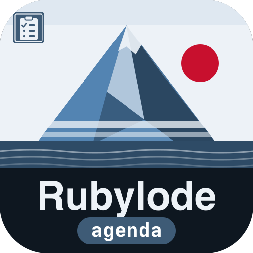

# Rubylode Agenda for Redmine

TL;DR: a dated meeting page for each [Redmine](https://www.redmine.org) project. The agenda sits next to what changed
since the last meeting: progress before and after, the tickets that were closed, and a few numbers. Any agenda line can
point at a ticket or become one. Several people can edit the same meeting at once.

The current version is 1.0.0. Needs Redmine 7.0 or newer. `docs/roadmap/ROADMAP.md` lists what is not done.

Contents:

- [What it does](#what-it-does)
- [Install](#install)
- [Enabling it](#enabling-it)
- [Settings](#settings)
- [Where it shows](#where-it-shows)
- [Restyling it](#restyling-it)
- [Troubleshooting](#troubleshooting)
- [Tests](#tests)
- [Releasing](#releasing)
- [License](#license)

## What it does

Each project keeps dated meetings. A meeting is a numbered list of topics. Each topic has a title, an owner and lettered
lines under it.

### The page

The header names the meeting ("Meeting of <date>") with an "open" pill, or the date it was closed, then the period and
"Change dates". The meeting switcher and the Start next and Close meeting buttons sit on the right.

Below are three columns. On the left is the topic rail: each topic with its number, title and two small badges: the
active lines (filled), and, when there are any, the carried lines with no change in its fold (outlined). Point at a
badge to see what it counts. Click a topic to scroll to it; the topic in view is
marked. The rail stays in view while you scroll. Under the topics are "Parked (N)", the KPI sheet and Progress page links
and Agenda settings, when they apply. In the middle is the agenda. On the right is the sidebar headed "Since the last
meeting". On a middle-sized screen the rail becomes a row of links above the agenda; on a narrow one everything stacks.

### Topics and lines

- Type a topic in the box under the list and press Enter. Pick its owner from the project's members.
- Type a line under a topic and press Shift+Enter. It is saved and the empty field below is ready for the next one.
- In a line, Enter starts a new line inside the same item. Shift+Enter saves the item and opens a new one right below it,
  at the same depth. Leaving the field saves it too. Backspace in a new, empty item removes it.
- ArrowUp at the very start of an item, or ArrowDown at its very end, moves to the item above or below.
- Long items wrap, and the line breaks you typed are kept. An item holds up to 2000 characters.
- Tab makes a line a sub-point of the line above it; Shift+Tab moves it back. Points are lettered (a, b, c), sub-points
  numbered (i, ii, iii) and the level below that has bullets. A line goes at most one level below the line above it, so
  Tab on the first line of a topic, or on a line already as deep as it may go, moves the focus as usual.
- Edit a line where it stands. Tick it when it is done.
- Each line has a small menu button (it shows when you point at the line or tab to it). A right click on the line opens the
  same menu. It holds: make a ticket, or open the ticket and show its details; indent; outdent; move up; move down; park;
  delete. The shortcut of each entry is printed beside it. A right click in a field with text selected, or with Shift held,
  gives the browser's own menu. Topics have the menu too, with move up, move down and delete.
- Drag the handle to reorder topics or lines. A line can be dragged into another topic of the same meeting. A dragged line
  keeps its depth as far as its new place allows.
- Escape leaves a field without saving.

### Ticket links

- Type `#123` alone as a line or a topic title. It links ticket 123 and takes the ticket's subject.
- A linked line shows the ticket number and its status. When the ticket is closed, the line is struck through.
- Click the arrow beside the number to open the latest note, the subtasks and the time logged under the line. A form there
  adds a note to the ticket.
- Press Ctrl+Enter (Cmd+Enter on a Mac) in a line, or choose "Make a ticket" in its menu, to make a ticket from it. The
  first line of the item is the subject and the rest the description. The form is filled in from the topic: the parent
  and version from the topic's ticket, the assignee from its owner. For a sub-point whose parent line has a ticket you may
  see, the parent and version come from that ticket instead. Change anything in the form before saving. Redmine's own
  permissions, trackers, workflow and required fields apply.
- Indenting a line never makes or changes a ticket.

The line menu also holds the ticket actions. Each follows Redmine's own permissions, workflow and required fields, and an
entry you may not use is greyed out:

- On a line without a ticket: "Make a child ticket of…" opens the ticket form with the parent field ready, and "Link a
  ticket…" links a ticket picked from a list (the line keeps its text).
- On a line with a ticket: "Change the ticket…" sets the status (only those the workflow allows you), assignee, priority,
  version, due date and percent done, with an optional note, in one change that Redmine records and mails as usual.
  "Make it a child of…" and "Make it the parent of…" tie two tickets together, "Remove the parent" undoes that, and
  "Unlink the ticket" drops the link and changes nothing in Redmine.
- The picker takes `#123` or a number, and lists the tickets already linked on this meeting that you may see. Type to
  filter it by number or subject.
- A changed ticket shows its new status at once on every line that shows it, in other windows too.
- A ticket the viewer may not see shows as plain text, with no number and no status.

### Several tickets at once

- Press "Make tickets" in the header (shown when you may edit the agenda and add tickets somewhere). Every line without a
  ticket gets a selection box in front, and each topic gets "Select all in this topic". Shift+click selects a range. A
  bar at the bottom says how many are selected. Escape or Cancel leaves without making anything.
- "Make tickets from this topic…" in a topic's menu, and "Select for tickets" in a line's menu, start the same with those
  lines selected. Lines that already have a ticket cannot be selected.
- "Review and create" shows one row per line, in agenda order: the subject (the first text line; the rest is the
  description), project, tracker, assignee, version and parent. The project is the agenda's, the tracker the first you
  may use, the assignee the topic's owner when that person can take tickets there. The parent is the ticket made from
  the line above it when that line is selected too ("line 1.a"), else that line's ticket, else the topic's ticket.
  Change anything; "Set for all rows" sets the project, tracker or assignee of every row at once.
- Nothing is made until you press the create button. All tickets are made in one go, parents first, through Redmine's own
  rules, or none: a refused row is marked with Redmine's message and everything you entered stays. Redmine notifies people
  about each new ticket as usual. At most 50 lines at a time.

### Carry-over, fold and parked

Starting the next meeting closes the open one. A new meeting is held today and its period runs from the previous
meeting's date. Lines are carried into it: notes that are not done, and lines whose ticket is still open. A line whose
ticket is closed is left behind. A topic with nothing to carry is left behind too. Carried lines keep their depth; when a
parent was left behind, its sub-points show one level higher until someone moves them.

A carried line shows how many times it has moved on ("carried 2x"). A carried line that nobody edited, and whose ticket has
not changed since the period began, is quiet. Quiet lines fold into one row, "N carried, no change". Open the row to see
them. Edit a folded line, or change its ticket, and it leaves the fold. Folded lines keep their depth inside the fold.

Choose Park in a line's menu, or press Alt+P while typing in it, to take it off the agenda and out of carry-over. The
collapsed "Parked" list under the agenda holds every parked line of the project with the topic it left and the date.
"Bring back" moves it into the open meeting, under the topic with the same title (made again if missing), as a point at
depth 0.

### Two people at once

The page asks the server for other people's changes every few seconds. A line or topic changed by someone else is updated
on your page. The field you are typing in is never replaced. If you save a line that someone else saved first, the save is
refused and both texts are shown: "Keep mine" saves yours over theirs, "Take theirs" drops yours. When the meeting is
closed by someone else, a notice says so at the top. Parking or bringing back a line in another window shows "reload to
refresh" on the Parked heading.

### The sidebar

The sidebar covers the meeting's period, from the start of its first day to the end of its last day. It shows:

- Progress, before and after, with the stages, when the Progress plugin is installed. Without it the section is left out.
- Five numbers: closed, opened, still open, average days to close and overdue.
- Closed per project when the project has a subproject you may see (the project's own tickets, then each direct
  subproject with everything under it), otherwise closed per category (most first, "No category" last). The rows add
  up to Closed.
- Closed per person, only when the project turns it on in the agenda settings (off by default). It lists people by name
  with their counts, not as a ranking.
- The closed tickets, grouped by version. Ten are listed and "Show more" opens the rest.

Each number tile, each row of the per-project or per-category list, each name under "Closed per person" and "See all N in the issue list" open Redmine's own issue list
of exactly the tickets behind the number, with the same project, subprojects, scope query and days; Redmine decides what
you may see there. A closed meeting's numbers are the ones stored when it closed, while the lists are live, and the card
says so. A number whose field the scope query already filters on has no link. Each number tile has a small line of that number over the last meetings (up to eight, from the stored snapshots of
closed meetings and the meeting shown); with fewer than two values there is none. The previous meeting's average days
and overdue count show under the current ones as "up from" or "down from". Overdue means open tickets
due before today while the meeting is open, and before the meeting's own date once it is closed. The per-project,
per-category and per-person lists are counted for the viewer when the page is shown and never stored; per person uses
each ticket's assignee at that time. A per-project row whose list Redmine cannot show exactly has no link: see
Troubleshooting.

### Snapshots on close

Closing a meeting stores its progress and its numbers as the person who closed it saw them. The sidebar of a closed meeting
says "As of" that date and reads the stored values, so they stay the same when more tickets are closed later. Only counts
are stored, never ticket lists. The list of closed tickets and the closed-per-person table are always read live, under the
viewer's own visibility.

## Install

Needs Redmine 7.0 or newer.

1. Put the plugin folder in Redmine's `plugins/` directory, named `redmine_rubylode_agenda`:

       cd /path/to/redmine/plugins
       git clone https://github.com/rubylode/redmine-rubylode-agenda.git redmine_rubylode_agenda

2. Run `bundle exec rake redmine:plugins:migrate RAILS_ENV=production`. It adds five tables.
3. Restart Redmine.

To remove it, run `bundle exec rake redmine:plugins:migrate NAME=redmine_rubylode_agenda VERSION=0 RAILS_ENV=production`,
delete the folder and restart. This deletes every meeting.

## Enabling it

1. In the project, open Settings, Modules, and check "Rubylode Agenda".
2. In Administration, Roles and permissions, give a role the permissions under the module's name:
   - "View the agenda" opens the page and the ticket panels. It is enough for a reader.
   - "Edit the agenda" starts, edits and closes meetings, and changes topics, lines, parking and the agenda settings.
     Making a ticket from a line also needs Redmine's own "Add issues", and adding a note needs "Add notes".

The Agenda tab then appears in the project menu, after Roadmap.

## Settings

Open them with "Agenda settings" under the agenda. Only people with "Edit the agenda" see the link.

| Setting | Meaning |
|---|---|
| KPI sheet link | A web address shown as "KPI sheet" under the agenda. Empty shows no link. |
| Progress page link | A web address shown as "Progress page" under the agenda. Empty shows no link. |
| Show closed per person | Off by default. When on, the sidebar lists how many tickets each person closed in the period, by name. |
| Tickets that count | A saved issue query of the project, or "Everything". The sidebar counts and lists only the tickets the query finds, in the project and its subprojects. |

The links must start with `http://` or `https://`.

The query only narrows the tickets counted in the sidebar. Progress is not narrowed by it. Only the query's filters are
used, never its sort or columns. A query the viewer may not see, or one that belongs to another project, is ignored.

The query's status filter is not used. A query saved in Redmine starts with "open tickets only", and the sidebar counts
open and closed tickets itself, so that filter is left out.

## Where it shows

- The project tab "Agenda", at `/projects/:id/agenda`. It opens the open meeting, or else the latest one. A project with no
  meeting says so and, for people who may edit, offers "Start the first meeting". The first meeting's period starts seven
  days before it.
- A meeting of its own, at `/projects/:id/agendas/:id`. A switcher above the agenda lists the meetings.
- "Change dates" in the header sets a meeting's date and period. The period of a closed meeting cannot be changed.
- The Progress plugin, if installed, supplies the progress percent and the stages. Without it everything else works.

## Restyling it

Every rule sits under `.rubylode-agenda`, every class starts with `rubylode-agenda-`, and every colour and size is a CSS
custom property named `--rubylode-agenda-...` with its default in `:where(:root)`. A theme overrides the properties.
The topic headings' rule and the primary buttons follow the theme's header colour (`--color-header-background`).
Buttons come in two kinds, `rubylode-agenda-button` (secondary: white, bordered) and `rubylode-agenda-button-primary`
(filled), on Redmine's own input and button elements; Redmine has no primary button class to borrow. One rule sits outside the
plugin's scope: on the agenda page it sets `#content` back to `overflow-x: visible`, so the rail can stay in view.
The rail moves above the agenda below about 1100 pixels, and the page stacks into one column below about 900 pixels.

## Troubleshooting

- The tab is missing: check that the module is enabled for the project and that your role has "View the agenda".
- You can read the agenda but cannot type: your role lacks "Edit the agenda".
- Ctrl+Enter opens nothing: you may not add issues to the project, or no tracker is open to you. "Make a ticket" in the
  line's menu is greyed out for the same reason. A line that already has a ticket offers "Open the ticket" instead.
- Tab moves the focus instead of indenting: the line is the first of its topic, or already one level below the line
  above it, or already a bullet. Shift+Tab on a point does the same.
- There is no menu on right click: you may only read the agenda, or you held Shift, or text was selected in the field.
- "Change the ticket…" is greyed out: you may neither edit the ticket nor add notes to it. A field is missing from the
  form: your role may not change it, or the workflow makes it read-only in the ticket's status.
- "Make it a child of…" or "Make it the parent of…" is greyed out or refused: your role lacks "Manage subtasks", or you
  may not edit the other ticket. Redmine's own message says why when it refuses, for example a parent that would make a
  loop.
- The picker says "No ticket with that number was found": the number is wrong, or the ticket is one you may not see.
- A row of "Closed per project" has no link: the scope query filters on something that list cannot show (a subproject
  filter, a field the subproject does not have), the query is the project's own while Redmine is set not to show
  subprojects' tickets, or you may not view issues in that subproject.
- "Make tickets" is missing: you may not edit the agenda, or you may not add tickets in any project.
- The review says nothing was created: the marked rows give Redmine's reasons, for example a required field, a tracker
  the project does not use, or a line someone else gave a ticket meanwhile. Fix those rows and create again.
- The topic rail does not stay in view: the window is narrower than about 1100 pixels, where it sits above the agenda.
- A line shows no number or status: the ticket is not one you may see.
- The sidebar shows no progress: the Progress plugin is not installed.
- A number is lower than expected: the sidebar counts only what you may see, in the project and its subprojects.
- A changed plugin file does not show: Redmine caches code in production. Restart it.

## Tests

    bin/test                                              all unit and integration tests
    bin/test test/integration/plugin_registered_test.rb   one file

They run in a Redmine 7 image with its test gems (`docker/test.Dockerfile`).

### Try it

A throwaway Redmine 7 with the plugin mounted and made-up data runs from this folder:

    ruby bin/demo up         start it and load the demo data; Redmine is on http://127.0.0.1:3021
    ruby bin/demo seed-busy  add the busy project "Lighthouse" (about a second; does nothing when it is there)
    ruby bin/demo restart    pick up a change to the plugin (it runs in production mode)
    ruby bin/demo down       stop it, keep the data
    ruby bin/demo reset      stop it and wipe the data

The project "Demo project" has twenty tickets, a saved query used as the scope, a closed meeting held eight days ago and the
next meeting started from it, so there are carried lines, folded lines and a parked line. Sign in as `alex` or `sam` with
the password `password1234` in two browser windows, or as `reader`, who may only look. The administrator is admin / admin.
`ruby bin/demo seed-busy` adds a second project, "Lighthouse", with 1000 tickets (620 of them an old backlog), ten weekly
meetings and a saved query that leaves the backlog out, to see the meeting page on a long list of tickets. The data is throwaway; never run the demo task against a real tracker. `docs/plans/agenda-browser-checklist.md` lists what
to try by hand.

## Releasing

Push a `vX.Y.Z` tag whose version matches `version` in `init.rb` and has an entry in `CHANGELOG.md`. CI runs the tests, builds
`redmine_rubylode_agenda-X.Y.Z.zip` and publishes the GitHub release with the changelog entry as its notes. The archive holds
only what Redmine needs: `bin/`, `docs/`, `test/`, `docker/`, `lib/tasks` and the demo data are left out of it.

## License

GNU General Public License, version 2 or (at your option) any later version, the same as Redmine. See `LICENSE`.

Copyright (C) 2026  Nick Gorbikoff

No warranty, as the GPL says. The agenda adds its own tables. It changes your tickets only through what you do on its page,
and that goes through Redmine's own rules. Try it on a copy of your tracker first.
